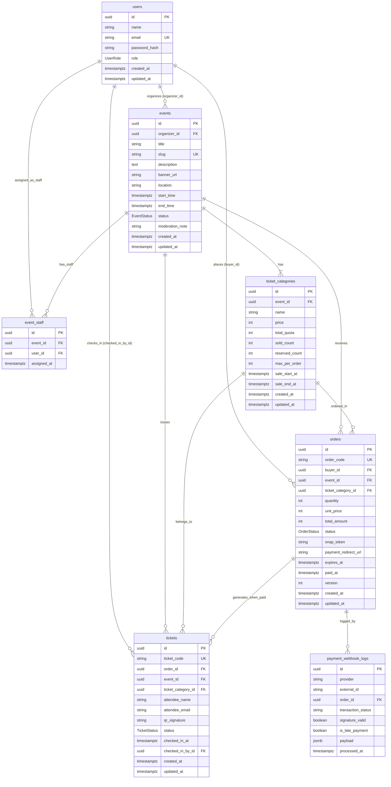

# 🗄️ Database Schema & Data Integrity Specification: Mozapass (`/docs/database-schema.md`)

- **Versi Dokumen:** 1.0.0
- **Tanggal Pembuatan:** 2026-11-14
- **Input Hulu:** `/docs/prd.md` (v1.0.0), `/docs/tech-stack.md` (v1.0.0)
- **Database Engine:** PostgreSQL 16 + Prisma ORM

---

## 1. Prinsip Desain Skema & Integritas Data

1. **Tanpa Tabel `OrderItem` (`A-010`):** Satu `Order` memuat tepat satu kategori tiket (`ticket_category_id`, `quantity`, `unit_price`, `total_amount` disimpan langsung di tabel `orders`). Hal ini membuat penguncian kuota (`SELECT ... FOR UPDATE`) hanya menyentuh satu baris kategori tiket per checkout dan **100% bebas deadlock**.
2. **Sabuk Pengaman Terakhir di Level Database (`BR-002`):** Selain penguncian di level aplikasi, tabel `ticket_categories` dilengkapi constraint PostgreSQL `CHECK (sold_count + reserved_count <= total_quota)` dan `CHECK (sold_count >= 0 AND reserved_count >= 0 AND total_quota > 0)`.
3. **Optimistic & Pessimistic Concurrency pada `orders`:** Tabel `orders` memiliki kolom `version` (`Int @default(1)`) dan `updated_at` (`TIMESTAMPTZ`) untuk menangani perubahan status yang tumpang tindih (misalnya webhook pembayaran masuk bersamaan dengan job kedaluwarsa `ST-008`).
4. **Standar Uang & Waktu (`BR-001`, `NFR-005`):** Seluruh kolom harga/nominal bertipe `INTEGER` (Rupiah penuh, tanpa desimal). Seluruh kolom waktu bertipe `TIMESTAMPTZ` dan disimpan dalam **UTC**.

---

## 2. Entity Relationship Diagram (ERD)



---

## 3. Definisi Enum Baku (Selaras 100% dengan PRD & Design)

| Nama Enum | Nilai yang Diizinkan | Referensi PRD & Design |
|---|---|---|
| `UserRole` | `BUYER`, `ORGANIZER`, `STAFF`, `ADMIN` | Bagian 2 PRD (RBAC) |
| `EventStatus` | `DRAFT`, `PUBLISHED`, `ENDED`, `CANCELLED`, `SUSPENDED` | `ST-001` s/d `ST-005` |
| `OrderStatus` | `PENDING`, `PAID`, `EXPIRED`, `CANCELLED`, `FAILED` | `ST-006` s/d `ST-010` |
| `TicketStatus` | `VALID`, `USED`, `VOID` | `ST-011` s/d `ST-013` |

---

## 4. Spesifikasi Detail per Tabel & Traceability

### 4.1 Tabel `users`
Menyimpan akun pengguna untuk seluruh role (`F-001`).
- `id` (`UUID`, PK, default `uuid_generate_v4()`)
- `name` (`VARCHAR(120)`, NOT NULL)
- `email` (`VARCHAR(255)`, UNIQUE, NOT NULL) — disimpan dalam huruf kecil (`lowercase`).
- `password_hash` (`VARCHAR(255)`, NOT NULL) — Bcrypt hash (`cost >= 10`).
- `role` (`UserRole`, NOT NULL, default `BUYER`)
- `created_at`, `updated_at` (`TIMESTAMPTZ`, UTC)

### 4.2 Tabel `events`
Menyimpan data acara yang dibuat oleh `ORGANIZER` (`F-002`, `F-003`, `F-010`).
- `id` (`UUID`, PK)
- `organizer_id` (`UUID`, FK → `users.id`, NOT NULL)
- `title` (`VARCHAR(200)`, NOT NULL)
- `slug` (`VARCHAR(220)`, UNIQUE, NOT NULL)
- `description` (`TEXT`, NOT NULL)
- `banner_url` (`TEXT`, NULLABLE)
- `location` (`VARCHAR(255)`, NOT NULL)
- `start_time`, `end_time` (`TIMESTAMPTZ`, NOT NULL) — wajib `end_time > start_time`.
- `status` (`EventStatus`, NOT NULL, default `DRAFT`)
- `moderation_note` (`TEXT`, NULLABLE) — diisi oleh `ADMIN` saat `ST-004` (`SUSPENDED`).
- `created_at`, `updated_at` (`TIMESTAMPTZ`, UTC)

### 4.3 Tabel `event_staff`
Menyimpan penugasan panitia scanner (`STAFF`) ke acara tertentu (`F-007`, `BR-009`).
- `id` (`UUID`, PK)
- `event_id` (`UUID`, FK → `events.id` ON DELETE CASCADE, NOT NULL)
- `user_id` (`UUID`, FK → `users.id` ON DELETE CASCADE, NOT NULL)
- `assigned_at` (`TIMESTAMPTZ`, default `NOW()`)
- **Constraint Unik:** `UNIQUE (event_id, user_id)` — mencegah duplikasi penugasan panitia di acara yang sama.

### 4.4 Tabel `ticket_categories`
Menyimpan kategori tiket per acara beserta penghitung kuota anti-oversell (`F-003`, `BR-001`, `BR-002`, `BR-004`, `BR-010`).
- `id` (`UUID`, PK)
- `event_id` (`UUID`, FK → `events.id` ON DELETE CASCADE, NOT NULL)
- `name` (`VARCHAR(120)`, NOT NULL)
- `price` (`INTEGER`, NOT NULL) — satuan Rupiah integer (`>= 0`, `BR-001`).
- `total_quota` (`INTEGER`, NOT NULL) — kapasitas total (`> 0`).
- `sold_count` (`INTEGER`, NOT NULL, default `0`) — jumlah tiket yang sudah `PAID`.
- `reserved_count` (`INTEGER`, NOT NULL, default `0`) — jumlah tiket yang sedang ditahan di order `PENDING`.
- `max_per_order` (`INTEGER`, NOT NULL, default `5`) — batas beli per checkout (`1..10`, `BR-004`, `A-002`).
- `sale_start_at`, `sale_end_at` (`TIMESTAMPTZ`, NOT NULL) — jendela penjualan aktif (`BR-004`).
- `created_at`, `updated_at` (`TIMESTAMPTZ`, UTC)
- **Database Check Constraint Wajib (`BR-002`):**
  - `CHECK (sold_count >= 0 AND reserved_count >= 0 AND total_quota > 0)`
  - `CHECK (sold_count + reserved_count <= total_quota)`

### 4.5 Tabel `orders`
Menyimpan transaksi pemesanan & reservasi kuota (`F-004`, `F-005`, `BR-001`, `BR-003`, `BR-011`, `A-010`).
- `id` (`UUID`, PK)
- `order_code` (`VARCHAR(40)`, UNIQUE, NOT NULL) — dikirim sebagai `order_id` ke Midtrans (contoh: `ORD-20261114-A1B2C3`).
- `buyer_id` (`UUID`, FK → `users.id`, NOT NULL)
- `event_id` (`UUID`, FK → `events.id`, NOT NULL)
- `ticket_category_id` (`UUID`, FK → `ticket_categories.id`, NOT NULL)
- `quantity` (`INTEGER`, NOT NULL) — jumlah tiket (`1 <= quantity <= max_per_order`).
- `unit_price` (`INTEGER`, NOT NULL) — snapshot harga kategori saat checkout (integer Rupiah).
- `total_amount` (`INTEGER`, NOT NULL) — `quantity * unit_price` (integer Rupiah).
- `status` (`OrderStatus`, NOT NULL, default `PENDING`)
- `snap_token` (`VARCHAR(255)`, NULLABLE) — token Midtrans Snap.
- `payment_redirect_url` (`TEXT`, NULLABLE)
- `expires_at` (`TIMESTAMPTZ`, NOT NULL) — `created_at + 15 minutes` (`BR-003`, `A-001`).
- `paid_at` (`TIMESTAMPTZ`, NULLABLE)
- `version` (`INTEGER`, NOT NULL, default `1`) — dinaikkan `+1` setiap kali status berubah untuk mencegah race condition antara job kedaluwarsa (`ST-008`) dan webhook pembayaran (`ST-007`).
- `created_at`, `updated_at` (`TIMESTAMPTZ`, UTC)

### 4.6 Tabel `tickets`
Menyimpan tiket individual yang terbit setelah pesanan `PAID` (`F-006`, `F-008`, `BR-005`, `BR-006`, `BR-007`).
- `id` (`UUID`, PK)
- `ticket_code` (`VARCHAR(32)`, UNIQUE, NOT NULL) — kode ramah baca untuk fallback input manual (`E-005`), contoh: `MOZA-8F92-K10A`.
- `order_id` (`UUID`, FK → `orders.id` ON DELETE RESTRICT, NOT NULL)
- `event_id` (`UUID`, FK → `events.id`, NOT NULL)
- `ticket_category_id` (`UUID`, FK → `ticket_categories.id`, NOT NULL)
- `attendee_name` (`VARCHAR(120)`, NOT NULL) — mengikuti nama `BUYER` (`A-004`).
- `attendee_email` (`VARCHAR(255)`, NOT NULL) — mengikuti email `BUYER` (`A-004`).
- `qr_signature` (`VARCHAR(64)`, NOT NULL) — tanda tangan HMAC-SHA256 (`BR-006`).
- `status` (`TicketStatus`, NOT NULL, default `VALID`)
- `checked_in_at` (`TIMESTAMPTZ`, NULLABLE) — diisi saat scan berhasil (`ST-012`).
- `checked_in_by_id` (`UUID`, FK → `users.id`, NULLABLE) — ID petugas `STAFF` / `ORGANIZER` yang memindai.
- `check_in_method` (`VARCHAR(16)`, NULLABLE) — `'QR_SCAN'` atau `'MANUAL'` (`E-005`).
- `created_at`, `updated_at` (`TIMESTAMPTZ`, UTC)

### 4.7 Tabel `payment_webhook_logs`
Menyimpan catatan audit dan kunci idempotensi setiap webhook pembayaran (`F-005`, `BR-008`, `E-002`, `E-003`, `NFR-006`).
- `id` (`UUID`, PK)
- `provider` (`VARCHAR(32)`, NOT NULL, default `'MIDTRANS'`)
- `external_id` (`VARCHAR(120)`, NOT NULL) — `transaction_id` + `transaction_status` dari Midtrans.
- `order_id` (`UUID`, FK → `orders.id`, NULLABLE)
- `transaction_status` (`VARCHAR(40)`, NOT NULL)
- `signature_valid` (`BOOLEAN`, NOT NULL)
- `is_late_payment` (`BOOLEAN`, NOT NULL, default `false`) — bernilai `true` jika webhook `settlement` masuk saat order sudah `EXPIRED` (`E-002`).
- `payload` (`JSONB`, NOT NULL) — payload mentah dari Payment Gateway.
- `processed_at` (`TIMESTAMPTZ`, NOT NULL, default `NOW()`)
- **Constraint Unik Idempotensi:** `UNIQUE (provider, external_id)` (`BR-008`).

---

## 5. Kode Lengkap `prisma/schema.prisma`

```prisma
generator client {
  provider = "prisma-client-js"
}

datasource db {
  provider = "postgresql"
  url      = env("DATABASE_URL")
}

enum UserRole {
  BUYER
  ORGANIZER
  STAFF
  ADMIN
}

enum EventStatus {
  DRAFT
  PUBLISHED
  ENDED
  CANCELLED
  SUSPENDED
}

enum OrderStatus {
  PENDING
  PAID
  EXPIRED
  CANCELLED
  FAILED
}

enum TicketStatus {
  VALID
  USED
  VOID
}

model User {
  id               String       @id @default(uuid()) @db.Uuid
  name             String       @db.VarChar(120)
  email            String       @unique @db.VarChar(255)
  passwordHash     String       @map("password_hash") @db.VarChar(255)
  role             UserRole     @default(BUYER)
  createdAt        DateTime     @default(now()) @map("created_at") @db.Timestamptz(3)
  updatedAt        DateTime     @updatedAt @map("updated_at") @db.Timestamptz(3)

  organizedEvents  Event[]      @relation("EventOrganizer")
  staffAssignments EventStaff[]
  orders           Order[]      @relation("BuyerOrders")
  checkedInTickets Ticket[]     @relation("CheckedInByStaff")

  @@map("users")
}

model Event {
  id               String           @id @default(uuid()) @db.Uuid
  organizerId      String           @map("organizer_id") @db.Uuid
  title            String           @db.VarChar(200)
  slug             String           @unique @db.VarChar(220)
  description      String           @db.Text
  bannerUrl        String?          @map("banner_url") @db.Text
  location         String           @db.VarChar(255)
  startTime        DateTime         @map("start_time") @db.Timestamptz(3)
  endTime          DateTime         @map("end_time") @db.Timestamptz(3)
  status           EventStatus      @default(DRAFT)
  moderationNote   String?          @map("moderation_note") @db.Text
  createdAt        DateTime         @default(now()) @map("created_at") @db.Timestamptz(3)
  updatedAt        DateTime         @updatedAt @map("updated_at") @db.Timestamptz(3)

  organizer        User             @relation("EventOrganizer", fields: [organizerId], references: [id], onDelete: Restrict)
  categories       TicketCategory[]
  staffAssignments EventStaff[]
  orders           Order[]
  tickets          Ticket[]

  @@index([status, startTime])
  @@index([organizerId])
  @@map("events")
}

model EventStaff {
  id         String   @id @default(uuid()) @db.Uuid
  eventId    String   @map("event_id") @db.Uuid
  userId     String   @map("user_id") @db.Uuid
  assignedAt DateTime @default(now()) @map("assigned_at") @db.Timestamptz(3)

  event      Event    @relation(fields: [eventId], references: [id], onDelete: Cascade)
  user       User     @relation(fields: [userId], references: [id], onDelete: Cascade)

  @@unique([eventId, userId])
  @@index([userId])
  @@map("event_staff")
}

model TicketCategory {
  id            String   @id @default(uuid()) @db.Uuid
  eventId       String   @map("event_id") @db.Uuid
  name          String   @db.VarChar(120)
  price         Int
  totalQuota    Int      @map("total_quota")
  soldCount     Int      @default(0) @map("sold_count")
  reservedCount Int      @default(0) @map("reserved_count")
  maxPerOrder   Int      @default(5) @map("max_per_order")
  saleStartAt   DateTime @map("sale_start_at") @db.Timestamptz(3)
  saleEndAt     DateTime @map("sale_end_at") @db.Timestamptz(3)
  createdAt     DateTime @default(now()) @map("created_at") @db.Timestamptz(3)
  updatedAt     DateTime @updatedAt @map("updated_at") @db.Timestamptz(3)

  event         Event    @relation(fields: [eventId], references: [id], onDelete: Cascade)
  orders        Order[]
  tickets       Ticket[]

  @@index([eventId])
  @@map("ticket_categories")
}

model Order {
  id                 String               @id @default(uuid()) @db.Uuid
  orderCode          String               @unique @map("order_code") @db.VarChar(40)
  buyerId            String               @map("buyer_id") @db.Uuid
  eventId            String               @map("event_id") @db.Uuid
  ticketCategoryId   String               @map("ticket_category_id") @db.Uuid
  quantity           Int
  unitPrice          Int                  @map("unit_price")
  totalAmount        Int                  @map("total_amount")
  status             OrderStatus          @default(PENDING)
  snapToken          String?              @map("snap_token") @db.VarChar(255)
  paymentRedirectUrl String?              @map("payment_redirect_url") @db.Text
  expiresAt          DateTime             @map("expires_at") @db.Timestamptz(3)
  paidAt             DateTime?            @map("paid_at") @db.Timestamptz(3)
  version            Int                  @default(1)
  createdAt          DateTime             @default(now()) @map("created_at") @db.Timestamptz(3)
  updatedAt          DateTime             @updatedAt @map("updated_at") @db.Timestamptz(3)

  buyer              User                 @relation("BuyerOrders", fields: [buyerId], references: [id], onDelete: Restrict)
  event              Event                @relation(fields: [eventId], references: [id], onDelete: Restrict)
  ticketCategory     TicketCategory       @relation(fields: [ticketCategoryId], references: [id], onDelete: Restrict)
  tickets            Ticket[]
  webhookLogs        PaymentWebhookLog[]

  @@index([buyerId, status])
  @@index([eventId, status])
  @@index([status, expiresAt])
  @@map("orders")
}

model Ticket {
  id               String         @id @default(uuid()) @db.Uuid
  ticketCode       String         @unique @map("ticket_code") @db.VarChar(32)
  orderId          String         @map("order_id") @db.Uuid
  eventId          String         @map("event_id") @db.Uuid
  ticketCategoryId String         @map("ticket_category_id") @db.Uuid
  attendeeName     String         @map("attendee_name") @db.VarChar(120)
  attendeeEmail    String         @map("attendee_email") @db.VarChar(255)
  qrSignature      String         @map("qr_signature") @db.VarChar(64)
  status           TicketStatus   @default(VALID)
  checkedInAt      DateTime?      @map("checked_in_at") @db.Timestamptz(3)
  checkedInById    String?        @map("checked_in_by_id") @db.Uuid
  checkInMethod    String?        @map("check_in_method") @db.VarChar(16)
  createdAt        DateTime       @default(now()) @map("created_at") @db.Timestamptz(3)
  updatedAt        DateTime       @updatedAt @map("updated_at") @db.Timestamptz(3)

  order            Order          @relation(fields: [orderId], references: [id], onDelete: Restrict)
  event            Event          @relation(fields: [eventId], references: [id], onDelete: Restrict)
  ticketCategory   TicketCategory @relation(fields: [ticketCategoryId], references: [id], onDelete: Restrict)
  checkedInBy      User?          @relation("CheckedInByStaff", fields: [checkedInById], references: [id], onDelete: SetNull)

  @@index([eventId, status])
  @@index([orderId])
  @@map("tickets")
}

model PaymentWebhookLog {
  id                String   @id @default(uuid()) @db.Uuid
  provider          String   @default("MIDTRANS") @db.VarChar(32)
  externalId        String   @map("external_id") @db.VarChar(120)
  orderId           String?  @map("order_id") @db.Uuid
  transactionStatus String   @map("transaction_status") @db.VarChar(40)
  signatureValid    Boolean  @map("signature_valid")
  isLatePayment     Boolean  @default(false) @map("is_late_payment")
  payload           Json     @db.JsonB
  processedAt       DateTime @default(now()) @map("processed_at") @db.Timestamptz(3)

  order             Order?   @relation(fields: [orderId], references: [id], onDelete: SetNull)

  @@unique([provider, externalId])
  @@index([orderId])
  @@map("payment_webhook_logs")
}
```

---

## 6. Constraint SQL Tambahan & Partial Index (Wajib di Migrasi Pertama)

Karena Prisma belum mendeklarasikan `CHECK` constraint dan *partial unique index* secara native di file `.prisma`, tambahkan blok SQL berikut di bagian akhir file migrasi pertama (`prisma/migrations/*_init/migration.sql`):

```sql
-- 1. Sabuk pengaman terakhir Anti-Oversell di level PostgreSQL (BR-002)
ALTER TABLE "ticket_categories"
  ADD CONSTRAINT "chk_ticket_categories_quota_non_negative"
  CHECK ("sold_count" >= 0 AND "reserved_count" >= 0 AND "total_quota" > 0);

ALTER TABLE "ticket_categories"
  ADD CONSTRAINT "chk_ticket_categories_no_oversell"
  CHECK ("sold_count" + "reserved_count" <= "total_quota");

-- 2. Validasi nominal dan kuantitas order positif (BR-001, BR-004)
ALTER TABLE "orders"
  ADD CONSTRAINT "chk_orders_positive_values"
  CHECK ("quantity" > 0 AND "unit_price" >= 0 AND "total_amount" = "quantity" * "unit_price");

-- 3. Satu reservasi PENDING aktif per acara per pembeli (BR-011)
CREATE UNIQUE INDEX "idx_orders_one_active_pending_per_buyer_event"
  ON "orders" ("buyer_id", "event_id")
  WHERE "status" = 'PENDING';
```

---

## 7. Pola Query Atomik (Wajib Dipatuhi di Service Layer)

### 7.1 Penguncian Kuota & Pembuatan Reservasi (`ST-006`, `BR-002`, `E-001`)
```sql
-- Di dalam prisma.$transaction:
-- Langkah 1: Kunci baris kategori tiket
SELECT id, price, total_quota, sold_count, reserved_count, max_per_order, sale_start_at, sale_end_at
FROM ticket_categories
WHERE id = $1
FOR UPDATE;

-- Langkah 2: Update kuota dengan guard tambahan
UPDATE ticket_categories
SET reserved_count = reserved_count + $2, updated_at = NOW()
WHERE id = $1 AND (sold_count + reserved_count + $2 <= total_quota);
```

### 7.2 Transisi Status Order dengan `version` (`ST-007` vs `ST-008`)
Untuk mencegah tabrakan saat webhook `settlement` (`ST-007`) masuk di detik yang sama dengan proses kedaluwarsa (`ST-008`):
```sql
UPDATE orders
SET status = 'PAID', paid_at = NOW(), version = version + 1, updated_at = NOW()
WHERE id = $1 AND status = 'PENDING' AND version = $2;
```

### 7.3 Check-in Tiket Atomik (`ST-012`, `BR-007`, `E-004`)
```sql
UPDATE tickets
SET status = 'USED', checked_in_at = NOW(), checked_in_by_id = $2, updated_at = NOW()
WHERE id = $1 AND event_id = $3 AND status = 'VALID';
```
Jika `affected_rows === 0`, lakukan `SELECT` baris tiket untuk menampilkan pesan spesifik: apakah tiket sudah `USED` (beserta waktu & petugas check-in sebelumnya) atau `VOID`.

---

## 8. Spesifikasi Seed Data Aman (`prisma/seed.ts`)

1. **Guard Keamanan Production:**
   - Baris pertama `seed.ts` wajib memeriksa:
     `if (process.env.NODE_ENV === 'production') { throw new Error('DILARANG menjalankan seed demo di production!'); }`
   - Password demo dibaca dari `process.env.SEED_DEMO_PASSWORD || 'MozaPass2026!'` dan di-hash menggunakan `bcryptjs`.
2. **4 Akun Demo (1 per Role):**
   - `buyer@mozapass.local` (Role: `BUYER`)
   - `organizer@mozapass.local` (Role: `ORGANIZER`)
   - `staff@mozapass.local` (Role: `STAFF`)
   - `admin@mozapass.local` (Role: `ADMIN`)
3. **2 Acara Contoh & Penugasan Staff:**
   - **Acara 1 (`PUBLISHED`):** *"Mozapass Tech & Music Fest 2026"* milik `organizer@mozapass.local`, lengkap dengan 2 kategori tiket (*Early Bird* Rp 150.000 kuota 100, *VIP Pass* Rp 350.000 kuota 50), serta menugaskan `staff@mozapass.local` di tabel `event_staff`.
   - **Acara 2 (`DRAFT`):** *"Design System Workshop Jakarta"* milik `organizer@mozapass.local` untuk menguji publikasi acara (`ST-001`).
4. **1 Order `PAID` + 1 Tiket `VALID` Siap Scan:**
   - Otomatis membuat 1 order berstatus `PAID` untuk `buyer@mozapass.local` pada Acara 1 dan menerbitkan **1 tiket berstatus `VALID`** (`ticket_code: "MOZA-DEMO-0001"`) dengan `qr_signature` HMAC-SHA256 yang valid dari `process.env.QR_SECRET_KEY`, sehingga fitur kamera scanner (`S-008`) dapat langsung diuji coba begitu aplikasi menyala.

---

## ✅ Quality Gate Report
- **✅ Lulus — Kesesuaian Aturan Bisnis & Anti-Oversell:** Skema tanpa `OrderItem` (`A-010`), constraint PostgreSQL `CHECK (sold_count + reserved_count <= total_quota)`, partial unique index `BR-011`, kolom `version` pada `orders`, dan `UNIQUE (provider, external_id)` pada `payment_webhook_logs` telah terkunci.
- **✅ Lulus — Konsistensi Enum & Tipe Data:** Keempat enum (`UserRole`, `EventStatus`, `OrderStatus`, `TicketStatus` = `VALID` / `USED` / `VOID`) identik di `prd.md`, `design.md`, dan `database-schema.md`; semua harga `Int` dan waktu `Timestamptz` UTC.
- **⚠️ Catatan:** Seed (`prisma/seed.ts`) telah menyertakan guard `NODE_ENV === 'production'` dan 1 tiket `VALID` (`MOZA-DEMO-0001`) siap scan.
