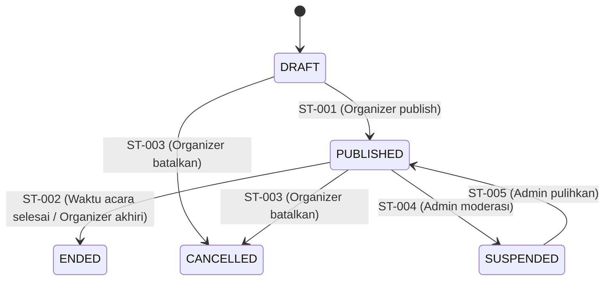
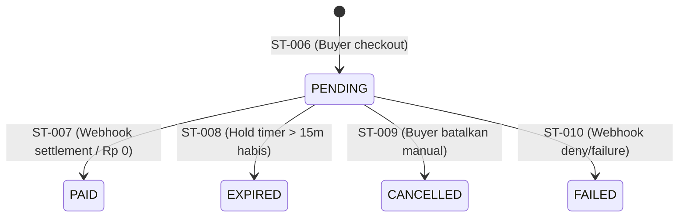
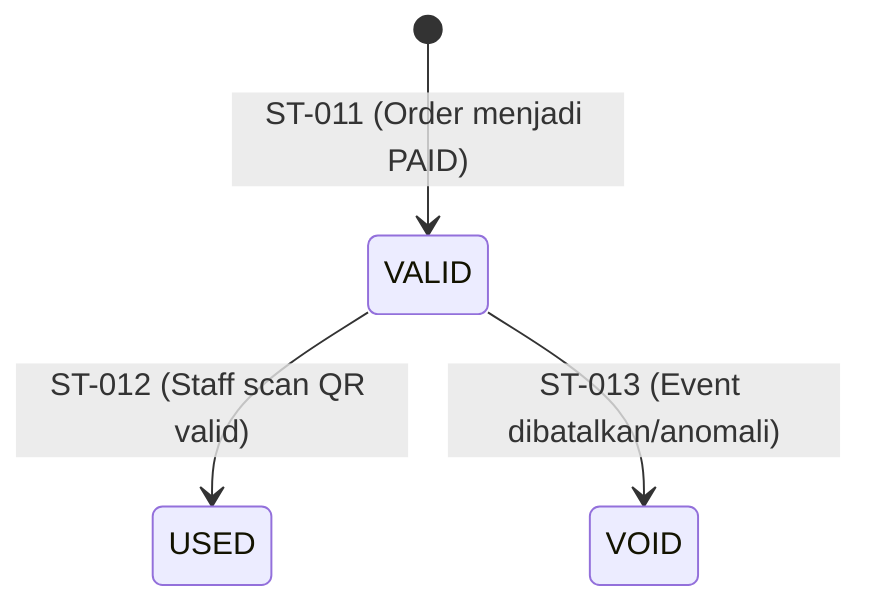

# 📄 Product Requirements Document (PRD): Mozapass

- **Versi Dokumen:** 1.0.0
- **Tanggal Pembuatan:** 2026-11-14
- **Status:** Final (Baseline MVP)
- **Target Platform:** Web Application (Next.js, Mobile-First Responsive, PWA-ready; Native APK Fase Lanjutan)

---

## 1. Ringkasan Eksekutif & Masalah Utama

### 1.1 Latar Belakang Masalah
Penyelenggara acara sering mengalami tiga masalah kritis dalam penjualan tiket daring:
1. **Overselling:** Kuota tiket terjual melebihi kapasitas akibat race condition saat trafik tinggi.
2. **Tiket Ganda & Pemalsuan:** QR code tiket mudah disalin atau dimanipulasi jika hanya berisi ID polos tanpa tanda tangan kriptografis, serta rawan dipakai masuk lebih dari satu kali.
3. **Inkonsistensi Status Pembayaran:** Webhook payment gateway yang terkirim berulang (retry) atau terlambat berisiko menerbitkan tiket ganda atau membatalkan pesanan yang sudah dibayar.

### 1.2 Solusi (Mozapass)
**Mozapass** adalah platform web ticketing acara end-to-end (responsif mobile-first) yang memungkinkan penyelenggara menjual tiket secara online dan pembeli memesan tiket dengan jaminan:
- **Anti-Oversell:** Mekanisme reservasi kuota atomik dengan batas waktu tahan (hold timer).
- **Webhook Idempotent:** Pemrosesan notifikasi pembayaran yang aman dari duplikasi.
- **Anti-Pemalsuan & Anti-Passback:** Tiket QR bertanda tangan kriptografis (signed payload) yang divalidasi secara real-time saat check-in oleh panitia melalui kamera browser.

### 1.3 Target & Metrik Keberhasilan (KPI Teknis & Portofolio)
- **Zero Oversell:** `0` kejadian jumlah tiket terjual + ditahan melebihi kuota kategori pada uji beban konkuren.
- **100% Webhook Idempotency:** Pengiriman ulang payload webhook yang sama tidak pernah menggandakan tiket atau mengubah state secara ilegal.
- **Kecepatan Check-in:** Validasi scan QR di lokasi selesai dalam `< 1 detik` pada koneksi internet stabil.

---

## 2. Peran Pengguna & Hak Akses (RBAC)

Kode role di bawah ini bersifat baku dan wajib identik di seluruh dokumen (`prd.md`, `database-schema.md`, `api-spec.md`, `design.md`, `AGENTS.md`).

| Kode Role | Nama Role | Deskripsi & Hak Akses Utama | Larangan Keras (Guardrail) |
|---|---|---|---|
| `BUYER` | Pembeli | Menjelajahi acara publik, membuat reservasi/order, membayar tiket, melihat daftar tiket milik sendiri beserta QR code, mengunduh/menerima email tiket. | Dilarang mengakses data pesanan/tiket milik `BUYER` lain, membuat acara, atau mengakses halaman scanner/dashboard penyelenggara. |
| `ORGANIZER` | Penyelenggara | Membuat & mengelola acara milik sendiri, mengatur kategori tiket (harga, kuota, jendela jual, batas beli), melihat daftar pesanan & peserta acara sendiri, menugaskan `STAFF` (panitia scanner), dan mengekspor CSV penjualan/peserta. | Dilarang melihat, mengubah, atau mengekspor data acara milik `ORGANIZER` lain. |
| `STAFF` | Panitia (Scanner) | Membuka halaman scanner kamera untuk acara yang ditugaskan kepadanya, melakukan scan/input kode tiket, melihat hasil validasi check-in dan statistik ringkas check-in acara tersebut. | Dilarang mengubah detail acara/kategori tiket, melihat laporan keuangan/pendapatan, mengekspor CSV peserta, atau melakukan scan pada acara yang tidak ditugaskan kepadanya. |
| `ADMIN` | Admin Platform *(Opsional / Moderasi)* | Melihat seluruh daftar acara di platform dan melakukan moderasi acara (misal: menangguhkan/suspend acara yang melanggar aturan). | Dilarang mengubah harga/kuota tiket penyelenggara secara sepihak atau melakukan check-in tiket peserta. |

> **Catatan Kepemilikan Data (Multi-Role / Scoped Access):**
> Satu akun pengguna dapat menjadi `BUYER` secara default, atau mendaftar/memilih peran sebagai `ORGANIZER`. Penugasan `STAFF` diikat secara spesifik ke pasangan `(event_id, user_id)` oleh `ORGANIZER` pemilik acara.

---

## 3. Alur Utama Pengguna (Core User Flows)

### 3.1 Alur Pembelian Tiket (`BUYER`)
1. `BUYER` registrasi atau login ke Mozapass.
2. `BUYER` menjelajahi katalog acara berstatus `PUBLISHED` dan membuka halaman detail acara.
3. `BUYER` memilih kategori tiket dan jumlah tiket (dalam rentang jendela penjualan aktif dan batas beli maksimum).
4. Sistem menjalankan transaksi atomik untuk menahan kuota sementara dan membuat pesanan berstatus `PENDING` dengan hitung mundur **15 menit** (`A-001`).
5. `BUYER` diarahkan ke halaman/modal pembayaran sandbox (Payment Gateway).
6. Setelah pembayaran berhasil, Payment Gateway mengirim webhook ke server Mozapass.
7. Server memverifikasi signature webhook secara idempotent, mengubah status pesanan menjadi `PAID`, menerbitkan tiket (`VALID`) dengan payload QR bertanda tangan, dan mengirim email berisi tiket QR ke `BUYER`.
8. Jika waktu 15 menit habis sebelum dibayar, pesanan otomatis berubah menjadi `EXPIRED` dan kuota tiket dikembalikan ke kategori terkait.

### 3.2 Alur Manajemen Acara (`ORGANIZER`)
1. `ORGANIZER` membuat acara baru (status awal `DRAFT`), mengisi informasi acara, waktu, lokasi, dan banner.
2. `ORGANIZER` menambahkan satu atau lebih kategori tiket (nama kategori, harga dalam Rupiah integer, kuota total, batas beli per transaksi, waktu mulai & selesai penjualan).
3. `ORGANIZER` mempublikasikan acara (`PUBLISHED`) agar tampil di halaman publik.
4. `ORGANIZER` menambahkan akun panitia (`STAFF`) berdasarkan email ke acara tersebut.
5. `ORGANIZER` memantau metrik penjualan & kehadiran di dashboard serta mengekspor data pesanan/peserta ke format CSV.

### 3.3 Alur Check-in Lokasi (`STAFF`)
1. `STAFF` login di browser smartphone dan memilih acara yang ditugaskan kepadanya.
2. `STAFF` mengizinkan akses kamera di browser untuk memindai QR code tiket peserta (atau memasukkan kode tiket secara manual jika kamera gagal fokus).
3. Server memvalidasi tanda tangan kriptografis QR, kecocokan acara, dan status tiket secara atomik:
   - Jika valid & belum dipakai (`VALID`) → ubah status menjadi `USED`, catat waktu & petugas check-in, tampilkan indikator **BERHASIL (Hijau)** beserta nama peserta & kategori.
   - Jika sudah pernah dipakai (`USED`) → tolak dan tampilkan indikator **SUDAH DIPAKAI (Merah)** beserta waktu check-in sebelumnya.
   - Jika tanda tangan palsu / salah acara / belum lunas → tolak dan tampilkan indikator **TIDAK VALID (Merah)**.

---

## 4. Daftar Fitur (MoSCoW Prioritization)

| ID | Nama Fitur | Prioritas | Role Terkait | Deskripsi Fitur |
|---|---|---|---|---|
| `F-001` | Autentikasi & Manajemen Peran | **Must-Have** | Semua Role | Registrasi, login, logout, sesi aman, pemilihan peran awal (`BUYER` / `ORGANIZER`), dan proteksi rute berbasis role (RBAC). |
| `F-002` | Katalog & Pencarian Acara Publik | **Must-Have** | `BUYER` ( & Publik) | Halaman daftar acara `PUBLISHED` dengan pencarian kata kunci, filter sederhana, serta halaman detail acara dan ketersediaan kategori tiket. |
| `F-003` | CRUD Acara & Kategori Tiket | **Must-Have** | `ORGANIZER` | Pembuatan, pembaruan, publikasi/pembatalan acara, serta pengaturan kategori tiket (harga integer Rupiah, kuota, batas beli, jadwal jual). |
| `F-004` | Checkout, Reservasi Kuota & Hold Timer | **Must-Have** | `BUYER` | Pemesanan tiket dengan penguncian kuota atomik (anti-oversell), halaman checkout dengan hitung mundur 15 menit, dan pelepasan kuota otomatis saat kedaluwarsa. |
| `F-005` | Pembayaran Sandbox & Webhook Idempotent | **Must-Have** | `BUYER`, Sistem | Integrasi Payment Gateway Sandbox (Midtrans Snap), pembuatan token/link bayar, dan endpoint webhook ber-verifikasi signature & idempotent. |
| `F-006` | Penerbitan Tiket QR Bertanda Tangan & Email | **Must-Have** | `BUYER`, Sistem | Pembuatan tiket individual per kursi/kuota setelah `PAID`, pembuatan QR code dengan tanda tangan HMAC-SHA256, tampilan tiket di web, dan pengiriman email tiket otomatis. |
| `F-007` | Manajemen Penugasan Panitia (`STAFF`) | **Must-Have** | `ORGANIZER` | Menambahkan dan mencabut akses user sebagai `STAFF` scanner pada acara tertentu milik `ORGANIZER`. |
| `F-008` | Scanner QR Kamera & Validasi Check-in | **Must-Have** | `STAFF`, `ORGANIZER` | Halaman pemindai QR menggunakan kamera browser (`getUserMedia`) + fallback input kode manual, umpan balik visual/audio instan, dan pencegahan double check-in. |
| `F-009` | Dashboard Penyelenggara & Ekspor CSV | **Must-Have** | `ORGANIZER` | Ringkasan penjualan (pendapatan kotor, tiket terjual, sisa kuota, jumlah check-in) per acara dan fitur unduh daftar peserta/tiket dalam format `.csv`. |
| `F-010` | Moderasi Acara oleh Admin | **Should-Have** | `ADMIN` | Halaman khusus `ADMIN` untuk meninjau daftar seluruh acara dan mengubah status acara bermasalah menjadi `SUSPENDED`. |
| `F-011` | Tiket Gratis (Rp 0) Instant Issuance | **Could-Have** | `BUYER`, `ORGANIZER` | Jika total harga pesanan adalah `Rp 0`, sistem melewati Payment Gateway dan langsung menerbitkan tiket (`PAID` & `VALID`). |
| `F-012` | Refund, Kode Promo & Wallet Internal | **Won't-Have (MVP)** | - | Dikeluarkan dari lingkup MVP sesuai keputusan produk; masuk ke peta jalan fase lanjutan. |
| `F-013` | Check-in Mode Offline / NFC / Biometrik | **Won't-Have (MVP)** | - | Check-in MVP wajib online untuk menjamin single-source-of-truth anti-passback. |

---

## 5. Aturan Bisnis (Business Rules)

| ID | Aturan Bisnis | Detail & Rumus Validasi |
|---|---|---|
| `BR-001` | **Satuan Uang Integer Rupiah** | Semua harga tiket dan total pembayaran disimpan dan dihitung sebagai bilangan bulat (`integer`) dalam satuan Rupiah penuh (contoh: `150000` untuk Rp150.000). Dilarang menggunakan `float`/`double`. Tidak ada fitur saldo/wallet internal. |
| `BR-002` | **Invarian Anti-Oversell Kuota** | Untuk setiap kategori tiket, setiap saat wajib berlaku: `sold_count + reserved_count <= total_quota`. Perubahan `reserved_count` dan `sold_count` wajib dilakukan di dalam transaksi database dengan row-level locking (`SELECT ... FOR UPDATE` atau operasi kondisional atomik). |
| `BR-003` | **Masa Aktif Reservasi (Hold Timer)** | Saat order dibuat (`PENDING`), kuota ditahan selama tepat **15 menit** (`expires_at = created_at + 15 minutes`, lihat `A-001`). Jika melewati `expires_at` dan belum `PAID`, status order menjadi `EXPIRED` dan `reserved_count` dikurangi kembali sejumlah tiket pada order tersebut. |
| `BR-004` | **Batas Pembelian & Jendela Penjualan** | `BUYER` hanya dapat memesan kategori tiket jika waktu server berada di antara `sale_start_at` dan `sale_end_at`, acara berstatus `PUBLISHED`, serta jumlah tiket dalam satu order tidak melebihi `max_per_order` kategori tersebut (default maks 5 tiket per order, `A-002`). |
| `BR-005` | **Satu Order Menghasilkan N Tiket Individual** | Jika satu order membeli `N` tiket dan berhasil dibayar (`PAID`), sistem menerbitkan `N` baris tiket terpisah (`Ticket`), masing-masing dengan `ticket_code` unik dan QR code unik. |
| `BR-006` | **Keamanan QR Code (Signed Payload)** | Payload QR code wajib memuat `ticket_code` dan `signature` kriptografis (`HMAC-SHA256(ticket_code + ":" + event_id, QR_SECRET_KEY)` dalam format `MOZA.<ticket_code>.<hmac16>`, lihat `A-005`). Scanner tidak pernah mempercayai data QR tanpa memverifikasi ulang signature dan status di database server. |
| `BR-007` | **Single Check-in (Anti-Passback)** | Satu tiket hanya dapat di-check-in (`VALID` → `USED`) **satu kali**. Operasi check-in wajib bersifat atomik (`UPDATE tickets SET status = 'USED', checked_in_at = NOW(), checked_in_by = :staff_id WHERE id = :id AND status = 'VALID'`). Jika baris yang terpengaruh = `0`, check-in ditolak. |
| `BR-008` | **Idempotensi Webhook Pembayaran** | Setiap notifikasi webhook dari Payment Gateway wajib diverifikasi signature-nya dan dicatat `external_transaction_id` / `order_id`-nya. Jika order sudah berstatus `PAID`, webhook duplikat wajib mengembalikan HTTP `200 OK` tanpa menerbitkan tiket baru atau mengirim ulang email. |
| `BR-009` | **Isolasi Tugas Scanner (`STAFF`)** | `STAFF` hanya diizinkan memindai tiket untuk `event_id` yang terdaftar pada tabel penugasan panitia (`event_staff`). Pemindaian tiket dari acara lain wajib ditolak dengan kode error otorisasi/ketidakcocokan acara. |
| `BR-010` | **Perlindungan Kategori Tiket yang Sudah Terjual** | Kategori tiket yang sudah memiliki pesanan (`reserved_count > 0` atau `sold_count > 0`) dilarang dihapus dan harganya dilarang diubah. `ORGANIZER` hanya boleh menaikkan `total_quota` (tidak boleh menurunkan di bawah `sold_count + reserved_count`). |
| `BR-011` | **Satu Reservasi Aktif per Acara per Pembeli** | Untuk mencegah penimbunan kuota (quota hoarding), satu `BUYER` hanya boleh memiliki maksimal 1 order berstatus `PENDING` pada acara yang sama di satu waktu. |

---

## 6. State Machine & Transisi Status (`ST-xxx`)

Sistem memiliki 3 entitas ber-status utama: **Acara (`Event`)**, **Pesanan (`Order`)**, dan **Tiket (`Ticket`)**.

### 6.1 State Machine Acara (`Event`)
Status yang diizinkan: `DRAFT`, `PUBLISHED`, `ENDED`, `CANCELLED`, `SUSPENDED`.

| ID | Entitas | Dari Status | Ke Status | Pemicu (Aktor) | Guard / Kondisi Wajib | Efek Samping |
|---|---|---|---|---|---|---|
| `ST-001` | `Event` | `DRAFT` | `PUBLISHED` | `ORGANIZER` pemilik | Acara memiliki minimal 1 kategori tiket yang valid dan jadwal acara di masa depan. | Acara tampil di katalog publik dan siap menerima order. |
| `ST-002` | `Event` | `PUBLISHED` | `ENDED` | `ORGANIZER` / Sistem | Waktu `end_time` acara telah terlewati atau diakhiri manual oleh pemilik. | Penjualan tiket ditutup; data tetap bisa diakses untuk laporan CSV. |
| `ST-003` | `Event` | `DRAFT` / `PUBLISHED` | `CANCELLED` | `ORGANIZER` pemilik | Tidak ada tiket berstatus `PAID` (untuk MVP, jika sudah ada tiket `PAID`, pembatalan butuh penanganan manual di luar MVP). | Semua reservasi `PENDING` dibatalkan; tiket tidak bisa dibeli lagi. |
| `ST-004` | `Event` | `PUBLISHED` | `SUSPENDED` | `ADMIN` | Acara melanggar kebijakan platform (dicatat alasan moderasi). | Acara disembunyikan dari publik dan checkout baru diblokir. |
| `ST-005` | `Event` | `SUSPENDED` | `PUBLISHED` | `ADMIN` | Masalah moderasi selesai dan waktu acara belum lewat. | Acara kembali tampil di publik. |

### 6.2 State Machine Pesanan (`Order`)
Status yang diizinkan: `PENDING`, `PAID`, `EXPIRED`, `CANCELLED`, `FAILED`.

| ID | Entitas | Dari Status | Ke Status | Pemicu (Aktor) | Guard / Kondisi Wajib | Efek Samping |
|---|---|---|---|---|---|---|
| `ST-006` | `Order` | *(Baru)* | `PENDING` | `BUYER` | `BR-002` (kuota cukup), `BR-004` (jendela jual & batas beli), `BR-011` (tidak ada order `PENDING` lain di acara sama). | `reserved_count` bertambah; `expires_at` diset `+15 menit`; token pembayaran dibuat. |
| `ST-007` | `Order` | `PENDING` | `PAID` | Webhook PG / Sistem (`F-011`) | Signature webhook valid (`BR-008`). | `reserved_count` berkurang, `sold_count` bertambah; terbitkan `N` tiket berstatus `VALID` (`ST-011`); kirim email tiket. |
| `ST-008` | `Order` | `PENDING` | `EXPIRED` | Sistem (Lazy check / Cron) / Webhook Expire | `NOW() > expires_at` dan status masih `PENDING`. | `reserved_count` dikurangi kembali sejumlah tiket dipesan; kuota pulih. |
| `ST-009` | `Order` | `PENDING` | `CANCELLED` | `BUYER` pemilik | Order masih `PENDING` dan belum dibayar. | `reserved_count` dikurangi kembali; kuota pulih seketika. |
| `ST-010` | `Order` | `PENDING` | `FAILED` | Webhook PG | Payment gateway mengirimkan status `deny` atau `cancel`. | `reserved_count` dikurangi kembali; kuota pulih. |

### 6.3 State Machine Tiket (`Ticket`)
Status yang diizinkan: `VALID`, `USED`, `VOID`.

| ID | Entitas | Dari Status | Ke Status | Pemicu (Aktor) | Guard / Kondisi Wajib | Efek Samping |
|---|---|---|---|---|---|---|
| `ST-011` | `Ticket` | *(Baru)* | `VALID` | Sistem (saat `ST-007`) | Order induk bertransisi menjadi `PAID`. | Generate `ticket_code` unik + payload QR HMAC-SHA256 (`BR-006`). |
| `ST-012` | `Ticket` | `VALID` | `USED` | `STAFF` / `ORGANIZER` | Signature QR valid (`BR-006`), tiket milik acara yang sedang di-scan (`BR-009`), status saat ini `VALID` (`BR-007`). | Isi `checked_in_at = NOW()` dan `checked_in_by = user_id`. |
| `ST-013` | `Ticket` | `VALID` | `VOID` | Sistem / `ORGANIZER` | Acara dibatalkan (`CANCELLED`) atau pembatalan administratif. | Tiket tidak lagi bisa digunakan untuk check-in (`ST-012` ditolak). |

---

## 7. Daftar Edge Cases & Penanganan (`E-xxx`)

| ID | Skenario Edge Case | Perilaku Sistem yang Wajib Terjadi |
|---|---|---|
| `E-001` | **Race Condition Sisa 1 Tiket:** Dua `BUYER` menekan tombol "Beli" di milidetik yang sama untuk 1 kuota tiket terakhir. | Transaksi database mengunci baris kategori tiket (`FOR UPDATE`). Transaksi pertama berhasil membuat order `PENDING`, transaksi kedua gagal validasi `BR-002` dan menerima respons HTTP `409 Conflict` (`QUOTA_EXCEEDED`) dengan pesan ramah bahwa tiket baru saja habis/ditahan pembeli lain. |
| `E-002` | **Late Webhook (Bayar di Detik Terakhir):** `BUYER` menyelesaikan pembayaran tepat saat timer 15 menit habis, sehingga webhook `settlement` masuk beberapa detik setelah order ditandai `EXPIRED`. | Saat memproses webhook `settlement` untuk order berstatus `EXPIRED`: jika `sold_count + reserved_count + order_qty <= total_quota`, sistem memulihkan order menjadi `PAID`, menambah `sold_count`, dan menerbitkan tiket. Jika kuota sudah terlanjur habis dibeli orang lain, sistem mencatat status anomali (`OVERBOOK_PAYMENT_ALERT`) di log audit dan mengirim notifikasi ke `ORGANIZER` untuk tindak lanjut manual, tanpa membuat `sold_count > total_quota`. |
| `E-003` | **Webhook Duplikat / Retry Badai:** Payment Gateway mengirim 5 webhook `settlement` identik secara bersamaan karena timeout jaringan. | Kunci idempotensi dan penguncian baris order memastikan hanya 1 request yang mengeksekusi transisi `ST-007`. Empat request lainnya mendeteksi order sudah `PAID` dan langsung merespons `200 OK` tanpa menduplikasi tiket atau email. |
| `E-004` | **Double Scan Serentak di Dua Pintu:** Dua `STAFF` memindai QR tiket yang sama secara bersamaan di pintu masuk berbeda. | Query update atomik (`WHERE id = :id AND status = 'VALID'`) menjamin hanya satu scanner yang mendapat `affected_rows = 1` (Sukses Hijau). Scanner kedua mendapat `affected_rows = 0` dan menampilkan peringatan merah `TICKET_ALREADY_USED` beserta nama petugas & waktu scan pertama. |
| `E-005` | **Kamera Browser Ditolak / Rusak di Lokasi:** `STAFF` tidak sengaja menolak izin kamera di browser HP atau layar HP pengunjung retak sehingga QR tidak terbaca kamera. | Halaman scanner menyediakan tombol fallback **"Input Kode Tiket Manual"** (memasukkan string `ticket_code` unik yang tertera di bawah QR) dengan validasi keamanan dan anti-passback yang sama. |
| `E-006` | **Kegagalan Pengiriman Email Tiket:** Pembayaran sudah `PAID` dan tiket sudah `VALID`, tetapi layanan SMTP/Email pihak ketiga sedang gangguan/timeout. | Kegagalan pengiriman email **tidak boleh** menggagalkan transaksi webhook `ST-007` (tiket tetap terbit dan langsung bisa dilihat/diunduh `BUYER` di menu "Tiket Saya" pada web). Sistem menyediakan tombol "Kirim Ulang Email Tiket" dan mencatat status pengiriman email. |
| `E-007` | **Re-aktivasi Kuota tanpa Cron Berat:** Job penjadwal (cron) terlambat berjalan padahal sudah ada order `PENDING` yang melewati `expires_at`. | Selain background/cron cleanup, setiap kali ada request baca ketersediaan tiket atau checkout baru pada suatu acara, sistem menjalankan *lazy expiration cleanup* untuk membebaskan order `PENDING` yang sudah `expires_at < NOW()` pada acara tersebut terlebih dahulu. |

---

## 8. Kebutuhan Non-Fungsional (`NFR-xxx`)

| ID | Kategori | Spesifikasi Kebutuhan |
|---|---|---|
| `NFR-001` | **Integritas & Konkurensi Data** | Database wajib menggunakan RDBMS yang mendukung transaksi ACID penuh dan row-level locking (PostgreSQL). Isolasi transaksi minimal `READ COMMITTED` dengan explicit row lock (`SELECT ... FOR UPDATE`) pada mutasi kuota dan check-in. |
| `NFR-002` | **Performa & Responsivitas** | Waktu respons API checkout dan validasi scan QR `p95 < 500ms` (di luar latensi pihak ketiga Payment Gateway). Halaman publik acara mendukung SSR/ISR di Next.js agar cepat diakses dari perangkat mobile. |
| `NFR-003` | **Desain Mobile-First & Kesiapan APK** | Seluruh antarmuka web (terutama halaman Tiket Pembeli dan Halaman Scanner Panitia) wajib didesain *mobile-first* (nyaman di layar lebar `360px–430px`) dan memisahkan logika API secara bersih agar siap dibungkus menjadi PWA atau digunakan oleh aplikasi mobile (Flutter/React Native) di fase berikutnya. |
| `NFR-004` | **Keamanan Aplikasi** | Seluruh rahasia (`QR_SECRET_KEY`, kunci Payment Gateway, kredensial DB) wajib disimpan di environment variable. Endpoint webhook wajib memvalidasi signature kriptografis dari Payment Gateway. Endpoint mutasi dilindungi dari CSRF/XSS dan menerapkan validasi skema input ketat (Zod). |
| `NFR-005` | **Standar Waktu & Mata Uang** | Semua timestamp disimpan di database dan dikirim lewat API dalam format **UTC ISO 8601** (dan ditampilkan sesuai zona waktu lokal acara/pengguna di UI). Semua nilai uang disimpan sebagai **integer Rupiah**. |
| `NFR-006` | **Observability & Audit Trail** | Setiap transisi status penting (`ST-007` pembayaran, `ST-008` kedaluwarsa, `ST-012` check-in) dan error webhook wajib dicatat ke structured log tanpa membocorkan password, token sesi, atau secret key. |

---

## 9. Daftar Asumsi & Open Questions (`A-xxx`)

Karena beberapa detail teknis spesifik diserahkan pada rekomendasi arsitektur terbaik untuk MVP, butir berikut ditetapkan sebagai **Asumsi Resmi (`A-xxx`)** yang dapat disesuaikan kapan saja oleh pemilik proyek:

| ID | Asumsi / Keputusan Default | Alasan Pemilihan Default | Status |
|---|---|---|---|
| `A-001` | **Durasi Hold Timer dikunci 15 Menit (`900 detik`).** | Rentang yang diminta adalah 10–15 menit; 15 menit selaras dengan durasi kedaluwarsa default sesi pembayaran Midtrans Snap/VA & QRIS sandbox. | Asumsi Aktif |
| `A-002` | **Batas Beli Default (`max_per_order`) adalah 5 tiket per transaksi** (dapat diatur `ORGANIZER` antara 1 s/d 10 saat membuat kategori). | Mencegah satu pengguna memborong seluruh kuota dalam satu klik sekaligus menyederhanakan form checkout. | Asumsi Aktif |
| `A-003` | **Payment Gateway Sandbox utama menggunakan Midtrans Snap.** | Dokumentasi lengkap, mendukung simulasi pembayaran instan di sandbox (QRIS, Virtual Account, GoPay), dan mekanisme signature webhook `SHA512` sangat jelas untuk portofolio Indonesia. | Asumsi Aktif |
| `A-004` | **Data Pemilik Tiket Mengikuti Akun Pembeli (`BUYER`).** | Untuk menjaga kecepatan checkout MVP, nama & email pada `N` tiket yang terbit mengikuti nama & email akun `BUYER` pemesan (tidak mewajibkan pengisian form KTP satu-satu untuk tiap kursi). | Asumsi Aktif |
| `A-005` | **Format Payload QR Code menggunakan string kompak bertanda tangan (`MOZA.<ticket_code>.<hmac_signature_16char>`)** | Tetap aman secara kriptografis (`HMAC-SHA256` dipotong atau penuh), sekaligus membuat kerapatan titik (density) QR code rendah sehingga **sangat cepat terbaca** oleh kamera HP kelas menengah ke bawah di lokasi acara yang redup. | Asumsi Aktif |
| `A-006` | **Stack Utama: Next.js (App Router, TypeScript) + PostgreSQL + Prisma ORM + Tailwind CSS.** | Kombinasi industri terpopuler untuk portofolio fullstack, mendukung transaksi interaktif `SELECT ... FOR UPDATE` di PostgreSQL untuk menjamin `BR-002` (anti-oversell). | Asumsi Aktif |
| `A-007` | **Autentikasi: JWT Session (`jose` + `bcryptjs`) via HTTP-Only Cookie & Header Bearer.** | Ringan, bebas masalah kompatibilitas edge/serverless, mendukung RBAC 4 role secara eksplisit, dan siap dipakai langsung oleh klien APK/Mobile di fase berikutnya. | Asumsi Aktif |
| `A-008` | **Email & QR Library: `nodemailer` (SMTP/Resend) + `qrcode` + `html5-qrcode`.** | `nodemailer` fleksibel (mendukung SMTP Gmail/Resend/Mailpit lokal), `qrcode` ringan di server, dan `html5-qrcode` paling stabil mengakses kamera belakang HP di browser mobile. | Asumsi Aktif |
| `A-009` | **Package Manager & Testing: `npm` + `Vitest` + Target Deploy Vercel & Neon/Supabase PostgreSQL.** | `npm` langsung berjalan tanpa instalasi tambahan di semua environment, dan `Vitest` sangat cepat untuk menguji logika bisnis (`BR-xxx`) serta state transition (`ST-xxx`). | Asumsi Aktif |
| `A-010` | **Satu Order Memuat Satu Kategori Tiket (`ticket_category_id`, `quantity`, `unit_price` langsung di tabel `orders`).** | Menyederhanakan skema (tanpa tabel `OrderItem`) dan menjamin penguncian kuota (`FOR UPDATE`) hanya mengunci 1 baris kategori per checkout sehingga bebas *deadlock*. | Asumsi Aktif |

---

## ✅ Quality Gate Report
- **✅ Lulus — Kelengkapan & Sistem ID:** Seluruh fitur (`F-001` s/d `F-013`), aturan bisnis (`BR-001` s/d `BR-011`), state machine (`ST-001` s/d `ST-013`), edge case (`E-001` s/d `E-007`), NFR (`NFR-001` s/d `NFR-006`), dan asumsi (`A-001` s/d `A-005`) telah memiliki ID unik dan definisi yang dapat diuji.
- **✅ Lulus — Konsistensi Role & Aturan Bisnis:** Keempat role (`BUYER`, `ORGANIZER`, `STAFF`, `ADMIN`) memiliki batasan hak akses tegas; aturan uang integer Rupiah, hold timer 15 menit, anti-oversell, webhook idempotent, dan single check-in telah dikunci.
- **⚠️ Catatan Konfirmasi:** Silakan tinjau bagian **9. Daftar Asumsi (`A-001` s/d `A-005`)** (misal penggunaan Midtrans Sandbox dan durasi 15 menit). Jika sudah sesuai, kita siap lanjut ke **Tahap 2: `design.md`**.
